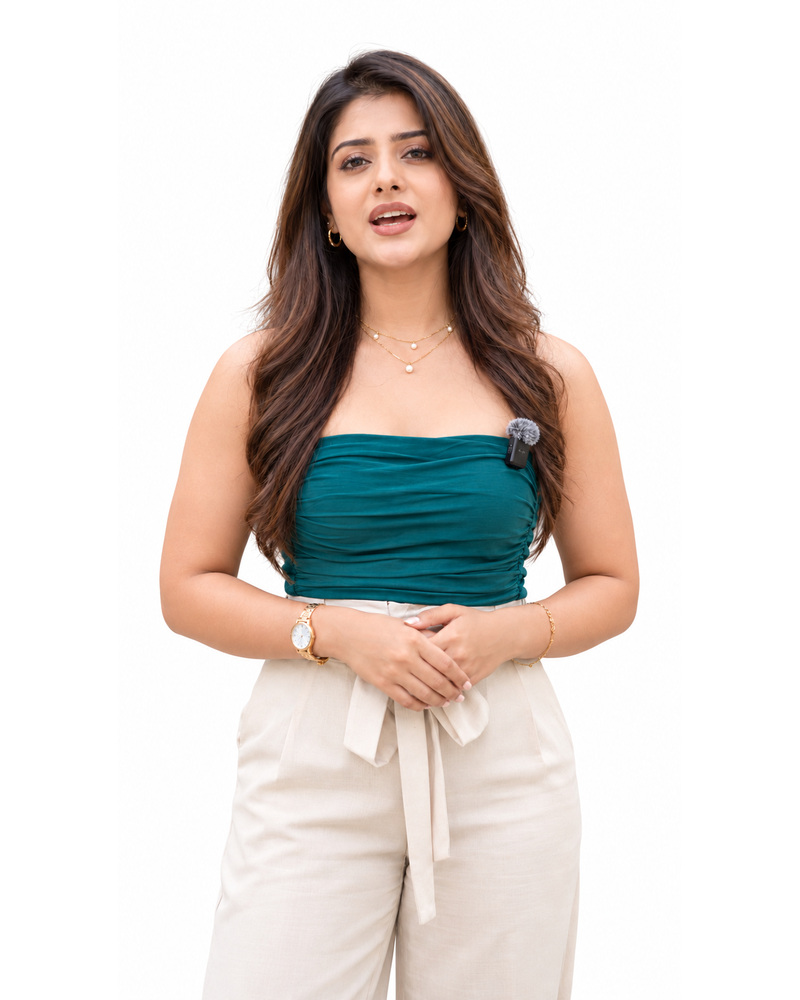
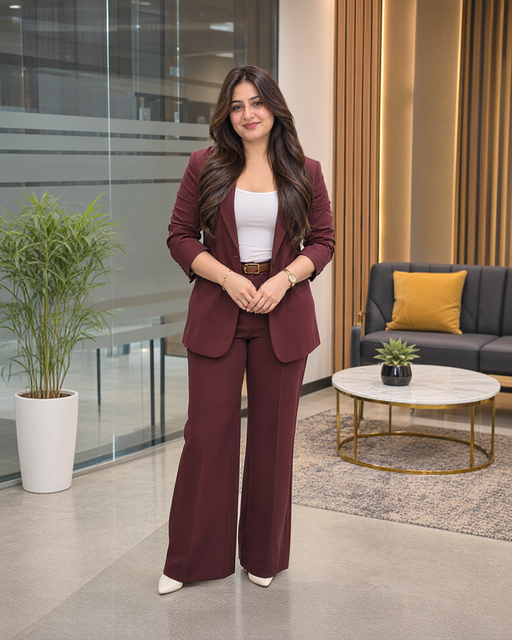

# DUC<!DOCTYPE html>
<html lang="en">
<head>
    <meta charset="UTF-8">
    <meta name="viewport" content="width=device-width, initial-scale=1.0, maximum-scale=1.0, user-scalable=no">
    <title>3D AI UGC & Creative Studio</title>
    
</head>
<body oncontextmenu="return false;">

    <!-- HERO SECTION WITH 3D PHONE-TILT AI ELEMENTS -->
    <header>
        

            
🤖

            
🎬

            
⚡

            
🎙️

        

        

            
⚡ 3D NEXT-GEN AI UGC STUDIO

            <h1>High-Converting AI UGC Videos For Your Business</h1>
            
Apna pasandida AI Character select karein, Monthly Offer ya Custom Package banayein aur seedha WhatsApp par order book karein.

            

                <a href="tel:+917597145560" class="btn btn-call">📞 Direct Call Now</a>
                <a href="#builder" class="btn btn-whatsapp">⚡ Select Package & Book</a>
            

        

    </header>

    <!-- LIVE 5,400+ INQUIRIES & TRUST COUNTER -->
    

        

            
5,482+

            
Live Inquiries

        

        

            
1,250+

            
Brands Served

        

        

            
4.9 ★

            
Client Rating

        

    

    <!-- 1. 7 SAMPLE VIDEOS SECTION (COMPACT SIZE) -->
    

        <h2 class="section-title">Our AI UGC Portfolio (7 Samples)</h2>
        
Realistic lip-sync, natural voice aur scroll-stopping hooks

        

            
<video src="video1.mp4" controls playsinline></video>
Sample #1

E-Commerce Ad

            
<video src="video2.mp4" controls playsinline></video>
Sample #2

Real Estate Tour

            
<video src="video3.mp4" controls playsinline></video>
Sample #3

Skincare Review

            
<video src="video4.mp4" controls playsinline></video>
Sample #4

App / Service Promo

            
<video src="video5.mp4" controls playsinline></video>
Sample #5

Fitness & Health

            
<video src="video6.mp4" controls playsinline></video>
Sample #6

Fashion & Lifestyle

            
<video src="video7.mp4" controls playsinline></video>
Sample #7

Local Business Ad

        

    

    <!-- 2. SELECTABLE AI CHARACTERS (6 MEN + 6 GIRLS + 6 BUSINESS) -->
    

        <h2 class="section-title">Tap to Select Your AI Character</h2>
        
Kisi bhi character par click karein — woh aapke package mein automatically add ho jayega

        
        

            <button class="tab-btn active" onclick="filterAvatars('all', this)">All (18)</button>
            <button class="tab-btn" onclick="filterAvatars('men', this)">👨 Men (6)</button>
            <button class="tab-btn" onclick="filterAvatars('girls', this)">👩 Girls (6)</button>
            <button class="tab-btn" onclick="filterAvatars('business', this)">🏢 Business (6)</button>
        

        

            <!-- 6 MEN CHARACTERS -->
            
✓ SELECTED
Men #1 - Aarav

Tech & Fitness

            
✓ SELECTED
Men #2 - Kabir

Casual & Lifestyle

            
✓ SELECTED
Men #3 - Rohan

Corporate & Finance

            
✓ SELECTED
Men #4 - Dev

Fashion & Grooming

            
✓ SELECTED
Men #5 - Aryan

Youth & Gadgets

            
✓ SELECTED
Men #6 - Alex

International Ads

            <!-- 6 GIRLS CHARACTERS -->
            
✓ SELECTED
Girl #1 - Ananya

Skincare & Beauty

            
✓ SELECTED
Girl #2 - Meera

Fashion & E-Com

            
✓ SELECTED
Girl #3 - Kiara

Daily Vlog Style

            
✓ SELECTED
Girl #4 - Riya

App & Service Promo

            
✓ SELECTED
Girl #5 - Naina

Health & Nutrition

            
✓ SELECTED
Girl #6 - Sophia

International Brands

            <!-- 6 BUSINESS / REAL ESTATE CHARACTERS -->
            
✓ SELECTED
Biz #1 - Vikram

Luxury Real Estate

            
✓ SELECTED
Biz #2 - Priya

Property Walkthrough

            
✓ SELECTED
Biz #3 - Rajeev

Business & B2B

            
✓ SELECTED
Biz #4 - Sneha

News & Explainer

            
✓ SELECTED
Biz #5 - Karan

Auto & Retail Ads

            
✓ SELECTED
Biz #6 - Neha

Coaching & Courses

        

    

    <!-- 3. MONTHLY SPECIAL OFFER PACKAGES -->
    

        <h2 class="section-title">🔥 Monthly Spe<!DOCTYPE html>
<html lang="en">
<head>
    <meta charset="UTF-8">
    <meta name="viewport" content="width=device-width, initial-scale=1.0, maximum-scale=1.0, user-scalable=no">
    <title>3D AI UGC & Creative Studio</title>
    
</head>
<body oncontextmenu="return false;">

    <!-- HERO SECTION WITH 3D PHONE-TILT AI ELEMENTS -->
    <header>
        

            
🤖

            
🎬

            
⚡

            
🎙️

        

        

            
⚡ 3D NEXT-GEN AI UGC STUDIO

            <h1>High-Converting AI UGC Videos For Your Business</h1>
            
Apna pasandida AI Character select karein, Monthly Offer ya Custom Package banayein aur seedha WhatsApp par order book karein.

            

                <a href="tel:+917597145560" class="btn btn-call">📞 Direct Call Now</a>
                <a href="#builder" class="btn btn-whatsapp">⚡ Select Package & Book</a>
            

        

    </header>

    <!-- LIVE 5,400+ INQUIRIES & TRUST COUNTER -->
    

        

            
5,482+

            
Live Inquiries

        

        

            
1,250+

            
Brands Served

        

        

            
4.9 ★

            
Client Rating

        

    

    <!-- 1. 7 SAMPLE VIDEOS SECTION (COMPACT SIZE) -->
    

        <h2 class="section-title">Our AI UGC Portfolio (7 Samples)</h2>
        
Realistic lip-sync, natural voice aur scroll-stopping hooks

        

            
<video src="video1.mp4" controls playsinline></video>
Sample #1

E-Commerce Ad

            
<video src="video2.mp4" controls playsinline></video>
Sample #2

Real Estate Tour

            
<video src="video3.mp4" controls playsinline></video>
Sample #3

Skincare Review

            
<video src="video4.mp4" controls playsinline></video>
Sample #4

App / Service Promo

            
<video src="video5.mp4" controls playsinline></video>
Sample #5

Fitness & Health

            
<video src="video6.mp4" controls playsinline></video>
Sample #6

Fashion & Lifestyle

            
<video src="video7.mp4" controls playsinline></video>
Sample #7

Local Business Ad

        

    

    <!-- 2. SELECTABLE AI CHARACTERS (6 MEN + 6 GIRLS + 6 BUSINESS) -->
    

        <h2 class="section-title">Tap to Select Your AI Character</h2>
        
Kisi bhi character par click karein — woh aapke package mein automatically add ho jayega

        
        

            <button class="tab-btn active" onclick="filterAvatars('all', this)">All (18)</button>
            <button class="tab-btn" onclick="filterAvatars('men', this)">👨 Men (6)</button>
            <button class="tab-btn" onclick="filterAvatars('girls', this)">👩 Girls (6)</button>
            <button class="tab-btn" onclick="filterAvatars('business', this)">🏢 Business (6)</button>
        

        

            <!-- 6 MEN CHARACTERS -->
            
✓ SELECTED
Men #1 - Aarav

Tech & Fitness

            
✓ SELECTED
Men #2 - Kabir

Casual & Lifestyle

            
✓ SELECTED
Men #3 - Rohan

Corporate & Finance

            
✓ SELECTED
Men #4 - Dev

Fashion & Grooming

            
✓ SELECTED
Men #5 - Aryan

Youth & Gadgets

            
✓ SELECTED
Men #6 - Alex

International Ads

            <!-- 6 GIRLS CHARACTERS -->
            
✓ SELECTED
Girl #1 - Ananya

Skincare & Beauty

            
✓ SELECTED
Girl #2 - Meera

Fashion & E-Com

            
✓ SELECTED
Girl #3 - Kiara

Daily Vlog Style

            
✓ SELECTED
Girl #4 - Riya

App & Service Promo

            
✓ SELECTED
Girl #5 - Naina

Health & Nutrition

            
✓ SELECTED
Girl #6 - Sophia

International Brands

            <!-- 6 BUSINESS / REAL ESTATE CHARACTERS -->
            
✓ SELECTED
Biz #1 - Vikram

Luxury Real Estate

            
✓ SELECTED
Biz #2 - Priya

Property Walkthrough

            
✓ SELECTED
Biz #3 - Rajeev

Business & B2B

            
✓ SELECTED
Biz #4 - Sneha

News & Explainer

            
✓ SELECTED
Biz #5 - Karan

Auto & Retail Ads

            
✓ SELECTED
Biz #6 - Neha

Coaching & Courses

        

    

    <!-- 3. MONTHLY SPECIAL OFFER PACKAGES -->
    

        <h2 class="section-title">🔥 Monthly Special Offer Plans</h2>
        
Limited time discounted packages for regular social media growth

        

            

                
25% OFF

                
🚀 15 Reels Monthly Offer

                
<del>₹14,999</del> ₹10,999 / month

                <ul class="offer-list">
                    <li>✅ 15 High-Converting AI UGC Reels</li>
                    <li>✅ Multiple Men & Girls AI Characters</li>
                    <li>✅ Viral Hook Scripts + Trending Subtitles</li>
                </ul>
                <a href="#builder" onclick="selectMonthlyOffer('offer15')" class="btn btn-call" style="width:100%; justify-content:center;">Select 15 Reels Offer</a>
            

            

                
35% OFF

                
👑 30 Reels Monthly Mega Offer

                
<del>₹29,999</del> ₹18,999 / month

                <ul class="offer-list">
                    <li>✅ 30 AI UGC Reels (Daily 1 Video)</li>
                    <li>✅ Custom Brand Avatar Free Included</li>
                    <li>✅ A/B Testing Hooks + Priority Delivery</li>
                </ul>
                <a href="#builder" onclick="selectMonthlyOffer('offer30')" class="btn btn-whatsapp" style="width:100%; justify-content:center;">Select 30 Reels Offer</a>
            

        

    

    <!-- 4. INTERACTIVE PACKAGE BUILDER -->
    

        <h2 class="section-title">Build Your Custom Package</h2>
        
Selected character aur services check karein, price dekhein aur book karein

        

            <!-- Selected Character Display -->
            

                <label class="form-label">1. Selected AI Character / Model:</label>
                

                    Men #1 - Aarav (Tech/Fitness)
                    <a href="#characters" class="change-char-link">Change Model ↑</a>
                

            

            <!-- Select Services -->
            

                <label class="form-label">2. Select Package or Services:</label>
                
                <label class="service-check offer-highlight">
                    <input type="checkbox" id="offer15" class="srv" data-name="15 Reels Monthly Offer Plan" value="10999" onchange="calculateTotal()"> 15 Reels Monthly Plan OFFER
                    ₹10,999
                </label>

                <label class="service-check offer-highlight">
                    <input type="checkbox" id="offer30" class="srv" data-name="30 Reels Monthly Mega Offer Plan" value="18999" onchange="calculateTotal()"> 30 Reels Monthly Plan BEST OFFER
                    ₹18,999
                </label>

                <label class="service-check">
                    <input type="checkbox" class="srv" data-name="1 Single AI UGC Video (30 Sec)" value="999" checked onchange="calculateTotal()"> 1 Single AI UGC Video (30 Sec)
                    ₹999
                </label>

                <label class="service-check">
                    <input type="checkbox" class="srv" data-name="3 AI UGC Videos Starter Bundle" value="2499" onchange="calculateTotal()"> 3 AI UGC Videos Bundle
                    ₹2,499
                </label>

                <label class="service-check">
                    <input type="checkbox" class="srv" data-name="Real Estate / Property Promo Video" value="1499" onchange="calculateTotal()"> Real Estate / Property Promo Video
                    ₹1,499
                </label>

                <label class="service-check">
                    <input type="checkbox" class="srv" data-name="Viral Script + 2 Extra Hooks" value="499" onchange="calculateTotal()"> Viral Script + 2 Extra Hooks
                    ₹499
                </label>

                <label class="service-check">
                    <input type="checkbox" class="srv" data-name="Custom AI Avatar Creation" value="1999" onchange="calculateTotal()"> Custom AI Avatar (Apna Face/Model)
                    ₹1,999
                </label>
            

            <!-- Client Details -->
            

                <label class="form-label">3. Your Details:</label>
                <input type="text" id="clientName" class="text-input" placeholder="Aapka Naam / Brand Name *" required>
                <input type="text" id="clientNote" class="text-input" placeholder="Koi special note ya product detail (Optional)">
            

            <!-- Live Total -->
            

                Estimated Total:
                ₹999
            

            <!-- Direct WhatsApp Book Now Button -->
            <button class="book-btn" onclick="bookNow()">🚀 Book Now on WhatsApp</button>
        

    

    <!-- 5. CLIENT FEEDBACK & RESPONSE SECTION -->
    

        <h2 class="section-title">Client Reviews & Share Your Response</h2>
        
Apna feedback ya experience yahan share karein

        

            <input type="text" id="revName" class="text-input" placeholder="Aapka Naam / Business Name">
            <textarea id="revMsg" class="text-input" rows="2" placeholder="Apna review ya message likhein..."></textarea>
            <button class="btn btn-call" style="width:100%; justify-content:center;" onclick="addReview()">💬 Submit Response</button>

            

                

                    
★★★★★ Rahul Sharma (E-Commerce Owner)

                    
Bahut hi realistic AI videos banaye hain, hamare Facebook ads ki cost half ho gayi!

                

                

                    
★★★★★ Amit Real Estate Jaipur

                    
24 ghante mein property walkthrough video mil gaya, super fast service.

                

            

        

    

    <!-- FLOATING CONTACT BAR -->
    

        <a href="tel:+917597145560" style="background:#38bdf8; color:#050811;">📞 Call Now</a>
        <a href="#builder" style="background:#22c55e; color:#fff;">⚡ Book Package</a>
    

    <!-- SCRIPTS -->
    
</body>
</html>
